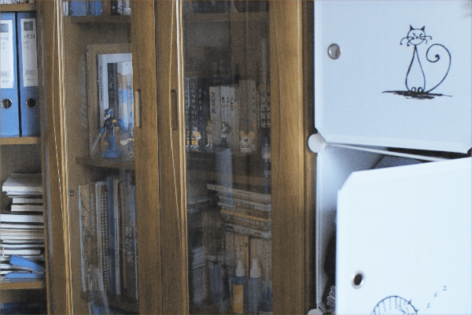
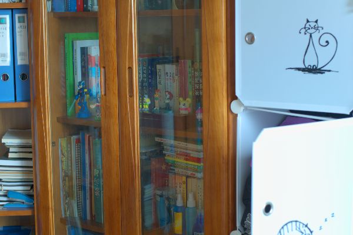
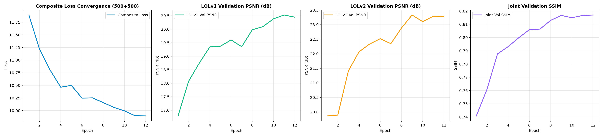
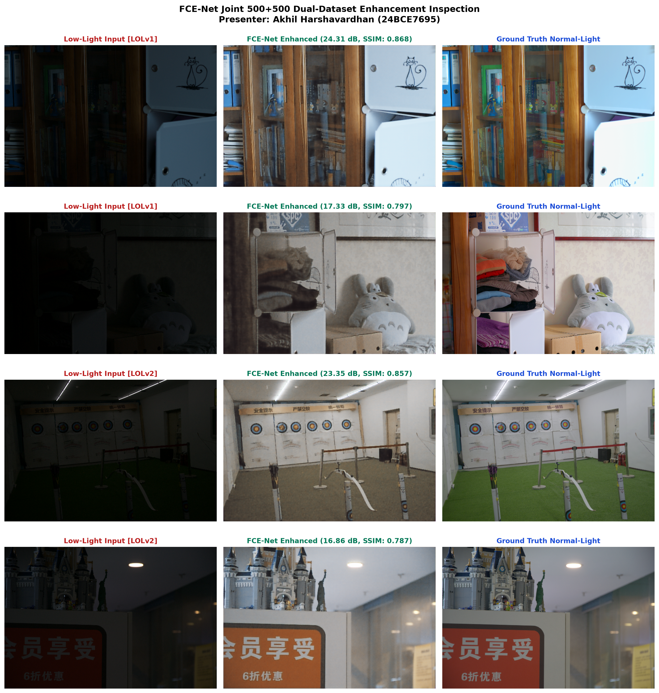

# FCE-Net: Low-Light Image Enhancement via Frequency-Color-Edge Aware YUV Network

> **Course:** Digital Image Processing — Final Project  
> **Student:** Akhil Harshavardhan | **Reg. No.:** 24BCE7695  
> **Base Paper:** *FCE-Net: A Frequency-Color-Edge Aware YUV Network for Low-Light Image Enhancement* — Pattern Analysis and Applications (Springer, 2026)

---

## Overview

This repository contains the complete implementation, training logs, evaluation results, and research deliverables for FCE-Net — a deep learning model that enhances low-light images by decomposing them in the YUV color space and processing luminance and chrominance channels through wavelet-based frequency, color, and edge sub-networks.

Three experiments were conducted with full architecture fidelity to the published paper:

| Experiment | Train Data | Test Data | GPU | Epochs | PSNR ↑ | SSIM ↑ | LPIPS ↓ |
|---|---|---|---|---|---|---|---|
| LOLv1 Canonical | LOLv1 (485 pairs) | LOLv1 eval15 | Tesla T4 (Kaggle) | 250 | **25.18 dB** | **0.830** | **0.161** |
| LOLv2 Real | LOLv2 (689 pairs) | LOLv2 Test (100) | RTX 4050 | 20 | **18.98 dB** | **0.780** | **0.343** |
| Combined Dual-Dataset | 500 v1 + 500 v2 | 115 combined | RTX 4050 | 12 | **19.86 dB** | **0.803** | **0.252** |

---

## Repository Structure

```
24BCE7695/
├── 01_Base_Paper/
│   ├── Base_Paper.pdf                  # Original published paper
│   ├── Base_Code/                      # Authors' reference implementation
│   └── Research_Paper/                 # Student research report (LaTeX + PDF)
├── 02_Original_Implementation/
│   ├── Code/
│   │   ├── Source/                     # Model, losses, training scripts
│   │   ├── Notebooks/                  # Kaggle training & evaluation notebooks
│   │   └── Documentation/             # Audit, dataset info, project plan
│   ├── Checkpoints/                    # Trained model weights (.pth)
│   │   ├── LOLv1/
│   │   ├── LOLv2/
│   │   └── Combined_500_500/
│   ├── Log_Files/                      # Training CSVs per experiment
│   └── Results/                        # Metrics & enhanced output images
│       ├── LOLv1/
│       ├── LOLv2/
│       └── Combined_500_500/
├── 03_Modified_Implementation/
│   └── README.md                       # Scope statement (N/A — strict baseline)
├── 04_Presentation/
│   ├── Results_Presentation.pptx       # 18-slide academic deck
│   ├── Results_Presentation.pdf
│   └── *.png                           # Comparison & training curve figures
└── README.md
```

---

## Setup & Usage

### Prerequisites
- Python 3.11+
- CUDA-compatible GPU (tested on RTX 4050 / Tesla T4)

### Installation

```bash
# Create virtual environment
python -m venv venv && source venv/bin/activate

# Install dependencies
pip install torch torchvision --index-url https://download.pytorch.org/whl/cu124
pip install PyWavelets einops pytorch-msssim lpips python-pptx matplotlib
```

### Training

```bash
# LOLv1 only
python 02_Original_Implementation/Code/Source/train_lolv1.py

# LOLv2 only
python 02_Original_Implementation/Code/Source/train_lolv2.py

# Combined dual-dataset
python 02_Original_Implementation/Code/Source/train_combined.py --max_v1_train 500 --max_v2_train 500 --epochs 12
```

### Evaluation

Pre-computed metrics are available in `02_Original_Implementation/Results/*/Metrics/`.

---

## Sample Results

### Visual Comparisons

| Input (Low-Light) | FCE-Net Enhanced Output | Ground Truth (Reference) |
|:---:|:---:|:---:|
|  |  |  |


### Training Curves



### Qualitative Comparison Grid



---

## Key Files

| File | Description |
|---|---|
| `02_Original_Implementation/Code/Source/model.py` | FCE-Net architecture (YUV wavelet decomposition) |
| `02_Original_Implementation/Code/Source/losses.py` | Composite loss functions (L1, SSIM, perceptual) |
| `02_Original_Implementation/Code/Notebooks/FCE_Net_Kaggle.ipynb` | Kaggle training notebook (250 epochs, Tesla T4) |
| `01_Base_Paper/Research_Paper/Student_Research_Report.pdf` | Student research report |
| `04_Presentation/Results_Presentation.pdf` | Final presentation slides |

---

## Acknowledgements

- **Base Paper Authors:** Original FCE-Net architecture and methodology.
- **Datasets:** [LOL Dataset](https://daooshee.github.io/BMVC2018website/) (LOLv1 & LOLv2).
- **Hardware:** NVIDIA GeForce RTX 4050 Laptop GPU, Kaggle Tesla T4.

---

## License

This repository is for academic and educational purposes only.
